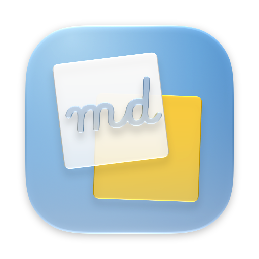
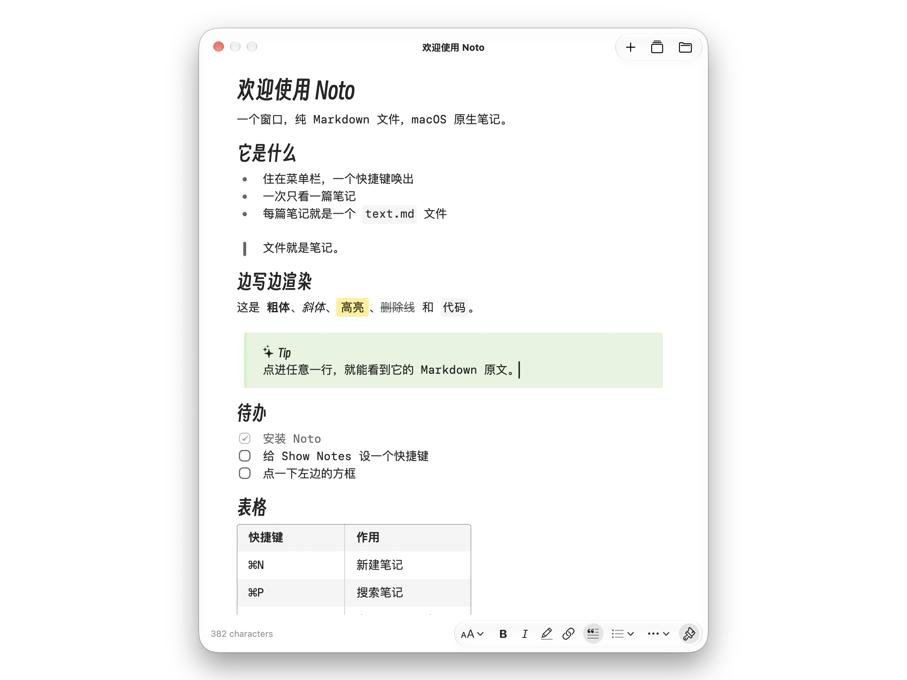

<p align="right"><a href="README.md">English</a> · 简体中文</p>

<p align="center">
  
</p>

<h1 align="center">Noto</h1>

<p align="center">一个窗口，纯 Markdown 文件，macOS 原生笔记。</p>

<p align="center">
  <a href="https://github.com/AFutureD/noto-releases/releases/latest">下载</a> ·
  <a href="#从源码构建">构建</a> ·
  <a href="docs/README.md">文档</a>
</p>

<p align="center">
  
</p>

Noto 在一个窗口里编辑一个文件夹里的笔记。每篇笔记是一个以标题命名的文件夹，正文在其中的 `text.md`。它常驻菜单栏，不需要账号，没有数据库。

## 特性

- Markdown 就地渲染。光标所在的结构显示标记，其余保持渲染。表格是网格，callout 是提示框，标题可折叠。
- 一个窗口，一次一篇。切换器（⌘P）搜索标题和正文。
- 四个全局快捷键：显示笔记、新建笔记、搜索笔记、置顶。
- 置顶后，窗口浮在其他应用之上，并出现在每个 Space。
- 字体和文件夹由你决定。应用自动更新。

## 安装

从[最新发布](https://github.com/AFutureD/noto-releases/releases/latest)下载 `Noto-<version>.dmg`，
把 Noto 拖进“应用程序”。需要 Apple Silicon 上的 macOS 26。

笔记存放在 `~/Library/Application Support/app.huanan.noto/Notes/`，一篇笔记一个文件夹，可在设置里改为任意文件夹。

## 从源码构建

需要 macOS 26 和 Xcode 27。

```sh
open Noto.xcodeproj    # 然后 ⌘R
```

架构、规范和各功能文档见 [docs/](docs/README.md)。

## 许可

Noto 派生自 [Tinycast](https://github.com/abue-ammar/tinycast) 的 Notes 功能，见 [NOTICE.md](NOTICE.md)。
以 [AGPL-3.0](LICENSE) 许可发布。
